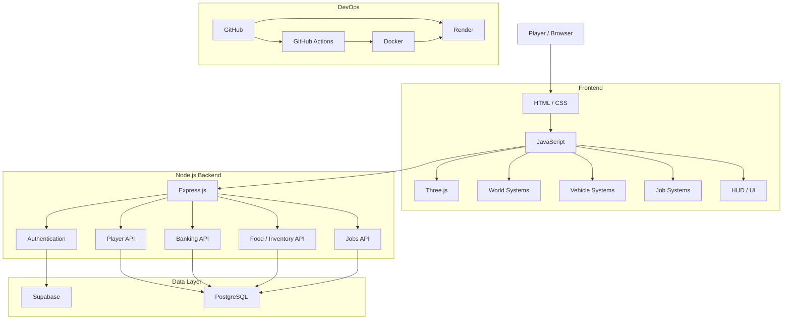

# Lagos Legends

> **THE CITY IS YOURS.**

Lagos Legends is a browser-based open-world life simulator inspired by everyday life, transportation, jobs, businesses, and social experiences in Nigeria.

The project is being developed as a **mobile-first, multiplayer-ready full-stack game platform** using JavaScript, Three.js, Node.js, Express, PostgreSQL/Supabase, Docker, and GitHub Actions.

> 🚧 **Status:** Active development — core gameplay systems are implemented, while economy, persistence, multiplayer, optimization, and world expansion are still in progress.

---

## 🎮 Project Overview

Lagos Legends is designed around an open-world Nigerian city where players can:

- Explore the city
- Create and customize a character
- Enter buildings and interiors
- Interact with NPCs
- Drive vehicles
- Navigate traffic
- Work different jobs
- Earn and manage money
- Buy food and manage hunger
- Maintain an inventory
- Eventually interact with other players in a shared multiplayer world

The long-term goal is to evolve the project into a scalable online life simulation platform.

---

## ✨ Current Features

### Character System

- Character creation
- Gender selection
- Appearance customization
- Persistent player profile architecture

### Open World

- 3D browser-based environment
- Nigerian-inspired city design
- Buildings and interiors
- Interactive world objects
- Collision detection
- Third-person camera
- Mobile controls

### Vehicles

- Enterable vehicles
- Vehicle movement
- Vehicle collision
- Driving controls
- Traffic system
- Public transportation foundations

### NPCs & World Systems

- NPC entities
- NPC interaction framework
- Traffic systems
- Environmental atmosphere
- Interactive buildings
- Shops and world interaction points

### Economy

- Player wallet
- Cash
- Bank balance
- Transactions
- Starter grant
- Banking deposits
- Banking withdrawals
- Transfers
- Transaction idempotency
- Food catalogue
- Inventory
- Hunger system
- Active-play hunger progression

### Jobs

Current job types:

| Job | Base Pay |
|---|---:|
| Delivery Driver | ₦1,500 |
| Taxi Driver | ₦1,800 |
| Dispatch Rider | ₦2,000 |
| Mechanic | ₦2,500 |
| Bus Driver | ₦3,000 |

These values are game-economy values and do not represent real-world salaries.

The job system is designed so that salary calculations are performed server-side rather than trusting values supplied by the client.

---

## 🏗️ Technology Stack

### Frontend

- HTML5
- CSS3
- JavaScript
- Three.js

### Backend

- Node.js
- Express.js
- PostgreSQL
- Supabase
- REST APIs

### DevOps

- Docker
- GitHub Actions
- Continuous Integration
- Render deployment

### Development

- Git
- GitHub
- npm

---

## 🧱 Architecture



---

## 🔐 Authentication & Security

Lagos Legends uses Supabase authentication together with a Node.js/Express backend.

The client does not directly determine important economy values.

For example, when a player completes a job:

```text
Player completes mission
        ↓
Frontend requests completion
        ↓
Express validates authenticated player
        ↓
Server determines job salary
        ↓
Database transaction
        ↓
Wallet updated
        ↓
Transaction recorded
```

The backend also uses idempotency keys for important financial operations to reduce the risk of duplicate payouts.

Secrets and credentials are provided through environment variables and are intentionally excluded from the repository.

---

## 🐳 Running With Docker

### Requirements

- Docker
- Git

Clone the repository:

```bash
git clone <YOUR_GITHUB_REPOSITORY_URL>
cd lagos-legends
```

Create your environment file:

```bash
cp .env.example .env
```

Add the required environment variables to `.env`.

Build the image:

```bash
docker build -t lagos-legends .
```

Run the container:

```bash
docker run --env-file .env -p 10000:10000 lagos-legends
```

The application should then be available through the mapped local port.

### Stop the container

Find the running container:

```bash
docker ps
```

Then:

```bash
docker stop <container_id>
```

---

## 🧪 Continuous Integration

GitHub Actions automatically validates the project when changes are pushed to `main` or submitted through a pull request.

The CI pipeline currently:

1. Checks out the repository
2. Installs dependencies
3. Validates backend JavaScript syntax
4. Validates frontend JavaScript syntax
5. Builds the Docker image

This helps catch broken code before deployment.

---

## 🚀 Deployment

The project is deployed through Render.

The production environment receives its required configuration through environment variables rather than storing credentials inside the repository.

The project is designed to support containerized deployment through the included `Dockerfile`.

---

## 📁 Project Structure

```text
lagos-legends/
│
├── .github/
│   └── workflows/
│       └── ci.yml
│
├── database/
│   └── schema.sql
│
├── public/
│   ├── index.html
│   ├── css/
│   │   └── style.css
│   └── js/
│       ├── main.js
│       ├── auth.js
│       ├── character.js
│       ├── worldSystems.js
│       ├── vehicleSystems.js
│       ├── npcSystems.js
│       ├── trafficSystems.js
│       ├── atmosphereSystems.js
│       ├── interiorSystems.js
│       └── jobSystems.js
│
├── server/
│   └── server.js
│
├── .dockerignore
├── .env.example
├── Dockerfile
├── package.json
├── package-lock.json
└── README.md
```

---

## 🛣️ Development Roadmap

### Foundation
- [x] Project foundation
- [x] Character system
- [x] 3D world
- [x] Collision system
- [x] Vehicle foundation
- [x] NPC system
- [x] Traffic
- [x] Interiors

### Economy
- [x] Player wallet
- [x] Banking
- [x] Transactions
- [x] Food system
- [x] Inventory
- [x] Hunger system
- [x] Job backend
- [ ] Complete job gameplay integration
- [ ] Additional job systems

### Persistence
- [ ] Persistent player state
- [ ] Persistent inventory
- [ ] Persistent character state
- [ ] Persistent world state

### Multiplayer
- [ ] Multiplayer architecture
- [ ] Player synchronization
- [ ] Shared world
- [ ] Server-authoritative gameplay
- [ ] Multiplayer optimization

### Expansion
- [ ] Larger world
- [ ] More businesses
- [ ] Housing
- [ ] Shops
- [ ] Advanced NPC behaviour
- [ ] More vehicles
- [ ] Mobile optimization
- [ ] Native/Unity migration research

---

## 🎯 Engineering Goals

Lagos Legends is not only a game project. It is also an ongoing exercise in building a full-stack application with:

- REST API architecture
- Authentication
- Database design
- Transactions
- Server-side validation
- Idempotent financial operations
- Containerization
- CI/CD
- Cloud deployment
- Real-time multiplayer architecture
- Mobile-first performance

The project is intentionally being developed incrementally, with systems being added and refactored as the architecture evolves.

---

## 👨🏾‍💻 Developer

**Lurd Henry**

Full-Stack Developer • Web Developer • Creative Technologist

This project is part of my ongoing portfolio and demonstrates my experience working across frontend development, backend APIs, databases, game systems, deployment, and DevOps.

---

## 📌 Project Status

Lagos Legends is an active work in progress.

The current build represents the foundation of the game's systems rather than the final release.

More features, optimization, persistence, multiplayer functionality, and world expansion are planned.
